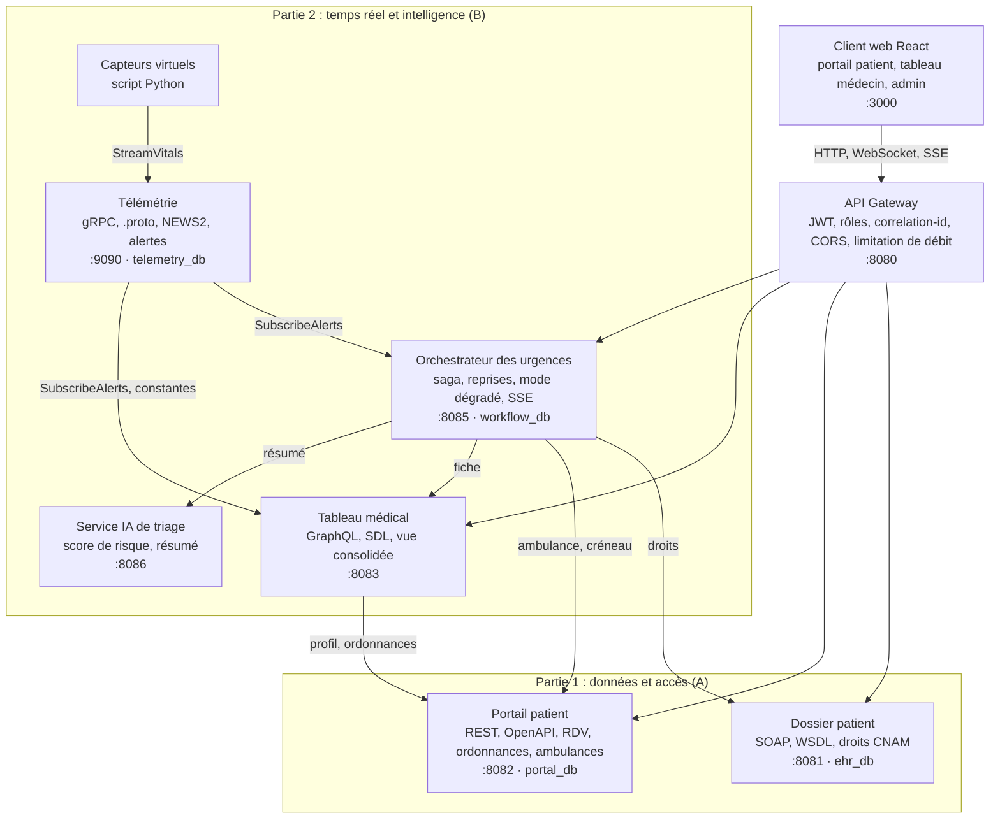
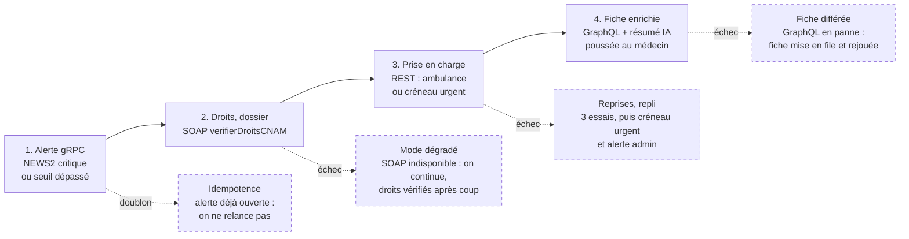
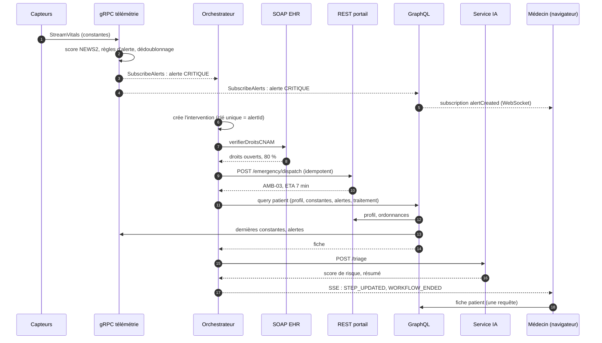

# Architecture

Les schémas sont écrits en [Mermaid](https://mermaid.js.org/) : GitHub, VS Code et la plupart des visionneuses Markdown les affichent directement.

## 1. Vue d'ensemble : 4 services, 1 gateway, 1 orchestrateur

Deux parties reliées seulement par des contrats d'interface (dossier `contracts/`).

Règles d'architecture :

- Le navigateur ne parle **qu'à la Gateway** ; il ne parle jamais gRPC.
- L'**orchestrateur** est le seul composant qui appelle les quatre services.
- Le service **gRPC** est la seule source des alertes (pour l'orchestrateur et le GraphQL).
- Les services internes ne vérifient pas le JWT : seule la Gateway authentifie (réseau Docker).
- Le service **SOAP** exige en plus un en-tête **WS-Security UsernameToken** (mot de passe haché, nonce) : la Gateway et l'orchestrateur l'ajoutent, le navigateur ne détient aucun secret.

## 2. Workflow d'urgence : 4 étapes, 4 replis

> La couverture d'assurance ne bloque **jamais** l'envoi des secours : elle sert à la facturation, d'où le mode dégradé de l'étape 2.
> Un SOAP Fault métier (droits expirés, patient inconnu) est un **résultat**, pas une panne.

Chaque étape écrit son statut dans `workflow_db` et le publie en SSE (page « Interventions »). Statuts d'étape :
`PENDING` → `RUNNING` → `SUCCEEDED`, ou `DEGRADED` (repli utilisé), ou `FAILED`.

### Séquence nominale

### Comportement en cas de panne

| Service coupé pendant l'intervention | Étape touchée | Comportement | Au retour du service |
|---|---|---|---|
| SOAP | 2. Droits | 3 essais, disjoncteur, étape `DEGRADED` (« vérification différée »). Les secours partent. | rejeu automatique, étape `SUCCEEDED` (« vérifié après coup ») |
| REST | 3. Prise en charge | 3 essais, repli sur un créneau d'urgence, **alerte admin** ; si le REST est totalement arrêté : `FAILED` + alerte admin | la fiche en attente est rejouée |
| GraphQL | 4. Fiche | étape `DEGRADED` (« fiche mise en file ») | rejeu automatique de la fiche |
| Service IA | 4. Fiche | résumé généré localement (`source: template-orchestrateur`), étape `SUCCEEDED` | rien à faire |
| Télémétrie | 1. Alerte | les abonnés (orchestrateur, GraphQL) se reconnectent toutes les 3 s | reprise du flux |

## 3. Données

| Base | Service | Contenu |
|---|---|---|
| `ehr_db` | soap-ehr | patients (droits CNAM), nomenclature des actes, feuilles de soins, prises en charge |
| `portal_db` | rest-portal | patients, créneaux, rendez-vous, ordonnances, ambulances, envois d'urgence |
| `telemetry_db` | grpc-telemetry | constantes vitales (avec score NEWS2), alertes |
| `workflow_db` | orchestrator | interventions, étapes, journal d'exécution, tâches différées |

Les mêmes 20 patients (`PAT-000001` à `PAT-000020`, `contracts/seed/patients.json`) existent dans les bases et dans le simulateur.

## 4. Contrats

| Contrat | Fichier | Technologie |
|---|---|---|
| Dossier patient | `contracts/ehr/ehr.wsdl`, `ehr.xsd` | SOAP 1.1 document/literal |
| Portail patient | `contracts/portal.openapi.yaml` | REST, OpenAPI 3.0 |
| Tableau médical | `contracts/dashboard.graphql` | GraphQL (requêtes, filtres, subscription) |
| Télémétrie | `contracts/telemetry.proto` | gRPC (flux client et serveur) |
| Orchestrateur | `contracts/workflow-api.md` | REST + SSE |
| Conventions | `contracts/conventions.md` | identifiants, JWT, erreurs, ports |
